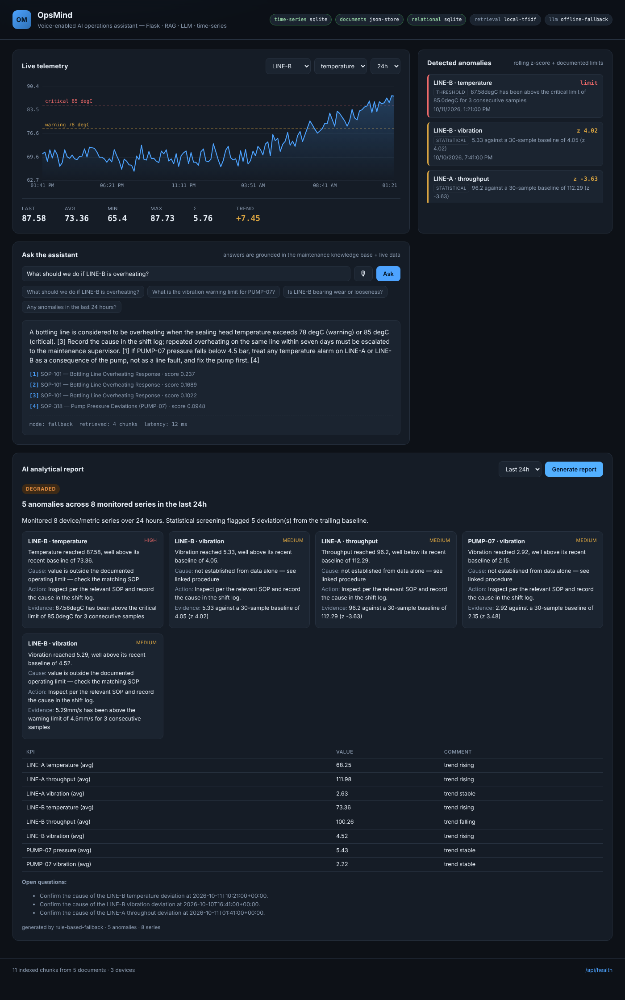

# OpsMind — Voice-Enabled AI Operations Assistant

A Flask service that lets a plant operator **ask, by voice, what is going wrong on the
production line** and get an answer grounded in the plant's own maintenance procedures,
plus an AI-written shift report backed by the actual telemetry.

Built as a single deployable app: Flask REST API + RAG pipeline + time-series analytics +
voice interface + LLM report generation.



**Live demo:** _<add your Replit URL here>_ · **Try:** click 🎙 and say *"what is the status of line B"*

---

## What it actually does

Three production lines stream temperature, vibration, pressure and throughput. The plant's
SOPs and maintenance log sit in a document store. OpsMind connects the two:

1. **Statistics find the problem.** A rolling z-score catches sudden spikes; documented
   engineering limits catch the slow drifts a rolling baseline hides (the baseline moves
   *with* a drift, so a line can climb 16 °C without ever scoring as a spike).
2. **RAG explains it.** The relevant SOP passages are retrieved and the answer cites them,
   so every claim is traceable to a document.
3. **The LLM writes it up.** A strict JSON schema turns the numbers and the retrieved
   procedures into a shift report a non-engineer can act on.
4. **Voice closes the loop.** The browser transcribes the question, the API routes it to a
   real action, and the answer is spoken back.

The demo data contains four planted faults. The system finds them without being told:
LINE-B overheating, LINE-B bearing wear, a PUMP-07 pressure drop, and the throughput loss
that follows the overheating.

---

## How each requirement is implemented

| Requirement | Where it lives |
|---|---|
| High-performance, scalable **Flask REST APIs** | `app/api.py` — blueprint, input validation, typed errors, app factory in `app/__init__.py` |
| **InfluxDB** for real-time / time-series | `app/timeseries.py` — Influx write/query layer, SQLite fallback behind the same interface |
| **MongoDB** | `app/stores.py` — documents, Q&A history, generated reports |
| **SQL** (PostgreSQL / MySQL) | `app/stores.py` — device registry and engineering thresholds, joined into the detector |
| **RAG pipeline** | `app/rag.py` — chunking, TF-IDF/remote embeddings, cosine search, re-ranking, citations |
| **LLM integration** | `app/llm.py` — OpenAI-compatible client, retries, JSON mode, defensive parsing |
| **Voice control / speech** | `app/voice.py` + `static/app.js` — Web Speech API → intent routing → action → TTS |
| **AI analytical reports** | `app/reports.py` — anomaly stats → strict JSON schema → validated → Markdown |
| **Improve model output through evaluation and iteration** | `eval/run_eval.py` — see the numbers below |

---

## Retrieval evaluation

A fixed question set, each with the document **and the exact fact** the answer depends on.
Document hit-rate is easy to score 100% on; the metric that actually moves is whether the
answering sentence survived chunking.

```
python eval/run_eval.py --chunk-size 40  --chunk-overlap 0  --top-k 1
python eval/run_eval.py --chunk-size 110 --chunk-overlap 25 --top-k 4
```

| chunk size | overlap | top-k | doc hit@1 | **answer span recall** |
|---|---|---|---|---|
| 40 | 0 | 1 | 100% | **62%** |
| 40 | 10 | 2 | 100% | **75%** |
| 110 | 0 | 2 | 100% | **100%** |
| 110 | 25 | 4 | 100% | **100%** |

Small chunks retrieve the right document and still lose the sentence that answers the
question. The shipped defaults (110 / 25 / 4) come from this sweep; retrieval p50 is ~1 ms.

---

## Running it

### On Replit
1. Import the repo (or upload this folder) and press **Run**.
2. Open the webview. That is the whole setup — no database, no API key.
3. Optional, for real LLM answers: **Tools → Secrets**, add `LLM_API_KEY` (a free Groq key
   works), then Run again. `/api/health` will switch from `offline-fallback` to `remote`.

### Locally
```bash
pip install -r requirements.txt
python main.py                  # http://localhost:8000
python -m pytest -q             # 16 tests
python eval/run_eval.py         # retrieval evaluation
```

### Production shape
```bash
gunicorn main:app --bind 0.0.0.0:8000 --workers 2 --timeout 90
```
Set `INFLUX_URL`, `MONGO_URI` and `DATABASE_URL` and the same code uses the real databases —
each layer picks its backend at startup and reports the choice on `/api/health`.

---

## API

| Method | Endpoint | Purpose |
|---|---|---|
| GET | `/api/health` | status, resolved backends, index size |
| GET | `/api/devices` | device registry + thresholds (SQL) |
| POST | `/api/metrics/ingest` | write one point or a batch |
| GET | `/api/metrics` | raw series, filtered by device/metric/window |
| GET | `/api/metrics/summary` | per-series aggregates and trend |
| GET | `/api/anomalies` | statistical + limit-breach detection |
| GET/POST | `/api/documents` | list / add knowledge-base documents (re-indexed immediately) |
| POST | `/api/search` | raw retrieval, for debugging and evaluation |
| POST | `/api/ask` | **RAG**: grounded answer + citations + latency |
| POST | `/api/voice/command` | transcript → intent → action → spoken answer |
| POST | `/api/reports` | **AI analytical report** (structured JSON + Markdown) |
| GET | `/api/reports`, `/api/history` | generated reports, Q&A history |

```bash
curl -X POST localhost:8000/api/ask \
  -H 'Content-Type: application/json' \
  -d '{"question":"What should we do if LINE-B is overheating?"}'
```

```json
{
  "answer": "Reduce line speed to 80 percent and check the cooling fan [1] ...",
  "citations": [{ "marker": "[1]", "title": "SOP-101 — Bottling Line Overheating Response", "score": 0.237 }],
  "retrieved": 4,
  "mode": "llm",
  "latency_ms": 820
}
```

---

## Design decisions worth asking me about

- **Statistics detect, the LLM explains.** The model is never asked to find an anomaly in
  raw numbers — it interprets anomalies that z-scores and documented limits already found.
  That keeps detection deterministic and testable.
- **Two detectors, not one.** A rolling baseline is blind to slow drift. Adding the SQL
  threshold table as a second detector is what catches the LINE-B overheating.
- **Every layer degrades instead of failing.** No Influx → SQLite. No Mongo → JSON store.
  No API key → extractive answerer. A missing driver never takes the API down, and
  `/api/health` always states which path is live.
- **Citations are mandatory.** `build_context()` numbers the passages and the system prompt
  requires markers, so an unsupported sentence is visible rather than plausible.
- **Re-ranking penalises repeats.** Pure vector recall returned four near-identical chunks
  from one document; a small per-document penalty improved answer coverage.
- **The report is schema-validated.** `_coerce()` checks the model's JSON and clamps enums;
  if the model is unreachable or off-schema, a rule-based generator emits the same shape, so
  consumers never handle two formats.

## Honest scope

Demo data is generated (`app/seed.py`) with deliberate faults, not real plant telemetry.
Speech-to-text runs in the browser (Web Speech API) rather than server-side Whisper —
`/api/voice/transcribe` is the hook where server STT would go. The local TF-IDF retriever
keeps the demo dependency-free; set `EMBEDDINGS_URL` to use vector embeddings instead.

---

Mohammad Dabbas · [github.com/modabbas](https://github.com/modabbas) · mhd.dabbas98@gmail.com
